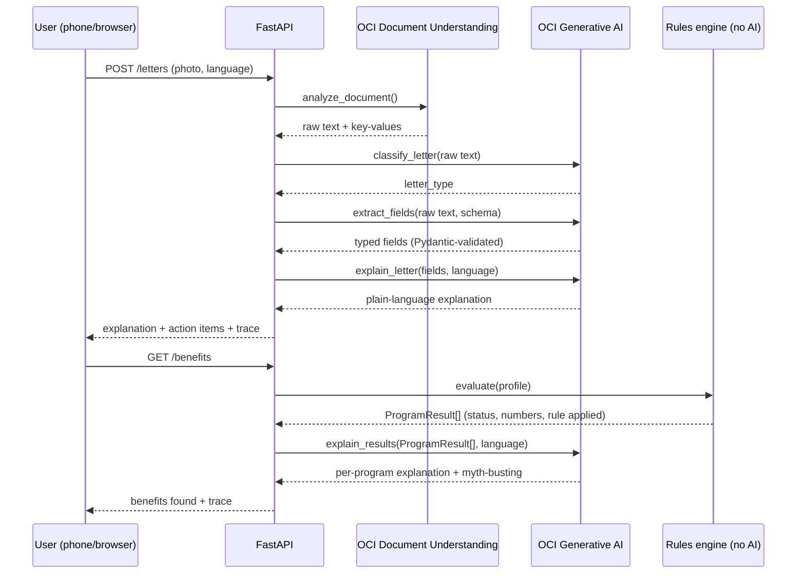

# LetterLens

Multilingual mail assistant for older immigrant New Yorkers. Built for
**#HackTN26 (Oracle)**.

Photograph a confusing English benefits letter (SSA, Medicare, HRA, a
medical bill) → the app explains it in your language → it uses the
extracted facts to:

1. **FIND** unclaimed benefits (Medicare Savings Program, Extra Help, SNAP)
2. **KEEP** benefits (renewal deadlines, document checklists)
3. **PROTECT** against illegal Medicare billing of QMB members
4. **APPLY** for MSP + Extra Help: the app fills in the application from
   the letters, asks only what's missing (by voice, in Mandarin or
   Cantonese), and the user reviews, signs, and says yes

Demo persona: Chen Yu-lan (陈玉兰), 74, Flushing, Queens, Mandarin speaker.

## Hard rules this architecture enforces

- **The LLM never decides eligibility.** `app/rules/engine.py` is pure,
  deterministic Python with zero network calls — it is the only place
  eligibility is decided. GenAI only ever extracts, classifies, explains,
  or drafts text.
- **Numbers never drift.** `app/number_guard.py` checks every GenAI output
  against its source facts; any invented number, date, or dollar amount
  raises an error instead of reaching the user.
- **Nothing is sent without the user's explicit yes.** The app fills in
  the application, but it only leaves draft after the user has seen every
  answer (with where it came from), signed, and tapped "Yes, send it for
  me." If documents are missing it goes to a caseworker instead.
- **Submission is simulated, and says so.** No NY State / HRA / SSA API
  accepts third-party filings; every application response carries
  `simulated: true` and the UI shows a "Demo" note. A real launch would
  file through an authorized-representative partner.
- **Sign in before anything personal.** A phone one-time code gates every
  screen that shows letters or builds an application. With no SMS
  provider configured, the code is shown on screen (`DEMO_SHOW_OTP=true`).
- **Every FIND result shows its work**: numbers used, rule applied, a
  confidence label, and "Final decision is made by NY State / HRA / SSA."
- **MOCK_MODE=true by default.** The entire stack — OCR, classification,
  extraction, explanation, translation, dispute-letter drafting — runs
  fully offline with deterministic canned responses. No OCI credentials
  are required to run or demo this project.
- **Raw uploaded images are never persisted.** Only OCR'd text and
  extracted structured fields reach the database.

## Architecture

```
┌──────────────────────────┐
│  React + Vite frontend     │   7 screens, mobile-first, 5 languages
└─────────────┬───────────────┘
              │ HTTP/JSON (CORS)
              ▼
┌──────────────────────────────────────────────────┐
│                    FastAPI app                      │
│   POST /letters     GET /letters                     │
│   GET  /reminders    GET /benefits                    │
└───┬────────────┬─────────────┬─────────────┬───────────┘
    │            │             │             │
    ▼            ▼             ▼             ▼
 app/docs     app/keep     app/protect    app/benefits
 (pipeline)   (reminders)  (QMB bill       (bridges stored
    │                       check)         profile -> rules
    │ OCI Document                         -> explain)
    │ Understanding + GenAI                    │
    │ (classify/extract/explain,               │
    │  mock by default)                        │
    ▼                                          │
    └──────────────┬───────────────────────────┘
                    ▼
         ┌───────────────────────┐
         │   app/rules.engine       │  pure Python, deterministic --
         │   (no LLM, no I/O)        │  the only place eligibility
         └────────────┬──────────────┘  is decided
                       │ ProgramResult[]
                       ▼
         ┌───────────────────────┐
         │   app/explain             │  GenAI explanation + myth-busting,
         │   (number_guard-checked)   │  per program, in user's language
         └────────────┬──────────────┘
                       ▼
         ┌───────────────────────┐
         │ SQLite via SQLModel        │  ProfileRecord / LetterRecord /
         │ (Oracle ADB = stretch swap)│  Reminder -- raw images never stored
         └───────────────────────┘
```

## APPLY: review, sign, submit

```
sign in (phone code)
  -> upload letters                     POST /letters
  -> "Apply for MSP + Extra Help"       POST /applications   (pre-fills from letters + sign-in)
  -> interview: only missing answers    PUT  /applications/{id}/fields/{key}
       voice (browser speech, zh-CN / zh-HK) or typing; app/apply/normalize.py
       turns "一九五二年三月五日" / "没有" into 1952-03-05 / 0 -- no LLM
  -> review every answer + its source, add document photos, sign
  -> "Yes, send it for me"              POST /applications/{id}/submit
       all documents present  -> submitted (confirmation number + timeline)
       documents missing      -> needs_review -> caseworker queue (/caseworker)
                                   approve -> submitted
                                   request info -> user fixes, resubmits
```

The application form (`app/apply/templates.py`) follows NY's DOH-4328 MSP
application; applying for MSP also gets Extra Help automatically. Document
photos are discarded on upload like letter images -- only "provided" is
recorded.

## OCI services used, and why

| Service | What it does | File : function |
|---|---|---|
| **OCI Document Understanding** | OCR + key-value extraction from the photographed letter | `app/docs/oci_client.py` : `_real_ocr` |
| **OCI Generative AI** — classify | Labels the letter as `ssa_benefit_letter` / `bank_statement` / `hra_renewal_notice` / `medical_bill` / `medicare_notice` / `other` | `app/docs/oci_client.py` : `_real_classify` |
| **OCI Generative AI** — extract | Extracts typed fields per a Pydantic schema for that letter type; one retry on invalid JSON before giving up | `app/docs/oci_client.py` : `_real_extract` |
| **OCI Generative AI** — explain | Plain-language explanation of a letter, or of one benefits result, in the user's language at a ~6th-grade reading level | `app/docs/oci_client.py` : `_real_explain`; `app/explain/oci_client.py` : `_real_explain` |
| **OCI Generative AI** — draft + translate | Drafts the QMB dispute letter and its side-by-side translation | `app/protect/oci_client.py` : `_real_english_letter`, `_real_translate` |
| **OCI Speech** *(stretch, not built)* | Voice questions + read-aloud answers | — |
| **Oracle Autonomous Database** *(stretch, not built)* | Swap-in for SQLite via the `oracledb` driver; `app/models.py` / `app/db.py` would be the only files touched | — |

Every real-mode call above shares one GenAI chat helper (`app/oci_genai.py`)
and has a MOCK_MODE path, independently toggled by the `MOCK_MODE` env var,
so the demo is never blocked by missing credentials or network access. The
real-mode implementations follow the OCI Python SDK's documented shapes but
are **unverified against a live tenancy** — treat them as a skeleton, not a
tested path. `scripts/check_oci.py` (see Testing below) is the fastest
way to find out which calls actually work once real credentials are set.

### Proving it, not just claiming it

The hard rule this whole project turns on is **the LLM never decides
eligibility** — `app/rules/engine.py` does, in pure deterministic Python.
That claim is checked at runtime, not just documented: `app/trace.py` times
every step of both the document pipeline and the benefits check and labels
each one with the OCI service that handled it, or `Rules engine (no AI)`
when it didn't touch AI at all. The frontend renders this as a collapsible
"How this was processed" panel (`frontend/src/components/TracePanel.jsx`)
on the Letter Result and Benefits Found screens — a judge can expand it and
see "Checked eligibility → Rules engine (no AI)" sitting right next to the
OCI-labeled steps, in the running app, not just in this README.



**Privacy**: the raw photographed image never touches disk or the
database — it's read into memory, passed to Document Understanding, and
discarded once extraction finishes (see the hard rules above). No
individual government records are looked up anywhere in this flow; the
rules engine only ever sees what the user uploaded or typed.

## Project layout

```
app/
  rules/        M1 -- pure deterministic eligibility engine (limits, income, engine)
  docs/         M3 -- OCR -> classify -> extract -> merge pipeline, POST/GET /letters
  explain/      M4 -- per-program GenAI explanation + myth-busting
  keep/         M5 -- renewal reminders with countdown, GET /reminders
  protect/      M5 -- QMB illegal-billing check + dispute letter draft
  benefits/     M7 -- bridges stored Profile -> rules engine -> explain, GET /benefits
  auth/         phone one-time-code sign-in, /auth/*
  apply/        application pre-fill, interview answer normalizing, review/sign/
                submit, caseworker queue -- /applications, /review-queue
  models.py     SQLModel tables: ProfileRecord, LetterRecord, Reminder
  db.py         SQLite engine/session (DATABASE_URL-configurable)
  number_guard.py / oci_genai.py   shared helpers used across the GenAI call sites
  main.py       FastAPI app, CORS, router wiring
tests/          82 tests: rules engine (A-J), document pipeline, explain,
                keep/protect, benefits endpoint, sign-in + applications
demo/           M7 -- fixtures, seed script, full persona walkthrough script
frontend/       M6 -- React + Vite UI: language, sign-in, letters, benefits,
                apply interview / review / status, caseworker queue
```

## Setup

### Backend

```bash
python3 -m venv .venv && source .venv/bin/activate   # optional
pip install -r requirements.txt
cp .env.example .env     # defaults already run fully offline
uvicorn app.main:app --reload --port 8000
```

### Frontend

```bash
cd frontend
npm install
cp .env.example .env.local   # points at http://localhost:8000 by default
npm run dev
```

Open the printed local URL (typically http://localhost:5173).

## Env vars

Root `.env` (backend, see `.env.example`):

| Var | Default | Purpose |
|---|---|---|
| `MOCK_MODE` | `true` | Run OCR/GenAI fully offline with canned responses |
| `DATABASE_URL` | `sqlite:///letterlens.db` | SQLModel connection string |
| `OCI_CONFIG_PATH` | `~/.oci/config` | Only read when `MOCK_MODE=false` |
| `OCI_CONFIG_PROFILE` | `DEFAULT` | Only read when `MOCK_MODE=false` |
| `OCI_COMPARTMENT_ID` | _(empty)_ | Required when `MOCK_MODE=false` |
| `OCI_GENAI_MODEL_ID` | _(empty)_ | Required when `MOCK_MODE=false` |
| `OCI_REGION` | `us-chicago-1` | Only read when `MOCK_MODE=false` |
| `DEMO_SHOW_OTP` | `true` | Return the sign-in code in the API response (no SMS provider yet) |
| `CASEWORKER_KEY` | `demo-caseworker` | Shared key for the `/review-queue` endpoints |

Frontend `frontend/.env.local` (see `frontend/.env.example`):

| Var | Default | Purpose |
|---|---|---|
| `VITE_API_BASE_URL` | `http://localhost:8000` | Backend base URL the UI calls |
| `VITE_CASEWORKER_KEY` | `demo-caseworker` | Pre-fills the key on the `/caseworker` screen |

Never commit `.env` or `.env.local` — both are gitignored.

## Running the tests

```bash
python3 -m pytest -q          # 82 tests: pure functions + FastAPI TestClient, no servers needed, MOCK_MODE only
cd frontend && npm run build && npm run lint
```

If you intend to demo with `MOCK_MODE=false`, run `python3 scripts/check_oci.py`
first (with real OCI credentials set) -- it calls OCI Document Understanding
and OCI Generative AI once each and prints OK/FAIL, so a broken credential
or region surfaces before you're on stage, not during.

## Running the demo

**Option A -- scripted transcript, no browser (fastest, <1s in practice):**

```bash
python3 demo/seed.py        # resets the demo SQLite DB
python3 demo/run_demo.py    # signs in, uploads all 4 sample letters, prints FIND/KEEP/PROTECT/APPLY
```

**Option B -- full UI walkthrough:**

```bash
# terminal 1
uvicorn app.main:app --port 8000
# terminal 2
cd frontend && npm run dev
```

Open the app, pick 中文, sign in with any 10-digit number (the code is
shown on screen), tap "Take a photo of a letter," and upload
one of the four watermarked SAMPLE images in `demo/`. They're clearly
marked fake documents — `MOCK_MODE` dispatches canned OCR text by
filename keyword, it never reads the pixels, so any renamed copy of these
files will misclassify.

Suggested order (persona: Chen Yu-lan, 74, Flushing, Queens):

1. `ssa_benefit_letter_sample.jpg` -- gross $1,700/mo explained
2. `bank_statement_sample.jpg` -- $40,000 savings (doesn't count for MSP)
3. `hra_snap_renewal_notice_sample.jpg` -- creates a reminder, deadline 2026-11-15
4. `medical_bill_sample.jpg` -- flagged as a possible illegal charge only
   if the profile's `on_qmb` is set (see note below)
5. "See benefits found" -- QMB / Extra Help (auto via QMB) / SNAP, all "likely"
6. "Apply for MSP + Extra Help" -- 4 of 9 answers pre-filled; answer the
   other 5 by voice; review, sign, "Yes, send it for me"
7. Open `/caseworker` in a second tab -- approve, or request info and
   watch the user's status change

**Known gap:** no letter type currently extracts age or current QMB
enrollment status -- nothing in the 4 extraction schemas captures either
fact. `demo/run_demo.py` sets both directly in the database with an inline
comment explaining why; a real intake flow or a QMB-card letter type would
replace that.

## Before presenting: verify the numbers

`app/rules/limits.py` is the single source of truth for every dollar
figure used in FIND (federal poverty level, QMB/QI income limits, Extra
Help income/resource limits, SNAP thresholds, the Medicare Part B
premium). Every row is tagged `VERIFY_BEFORE_DEMO` with a source URL --
these are best-effort 2026 figures, not fetched live. **Confirm each one
against the linked SSA / NY State page before presenting this to judges.**

## Git history

Each milestone was built and tested on its own branch, then
fast-forward-merged into `main`:

`m1-rules-engine` -> `m2-tests` -> `m3-document-pipeline` ->
`m4-explanation-layer` -> `m5-keep-protect` -> `m7-demo-fixtures` ->
`m6-frontend` -> `docs-readme` -> `fix-limits-verification` ->
`packet-readiness` -> `ios-pwa` -> `qmb-toggle` -> `demo-script` ->
`design-refresh` -> `oci-trace`
